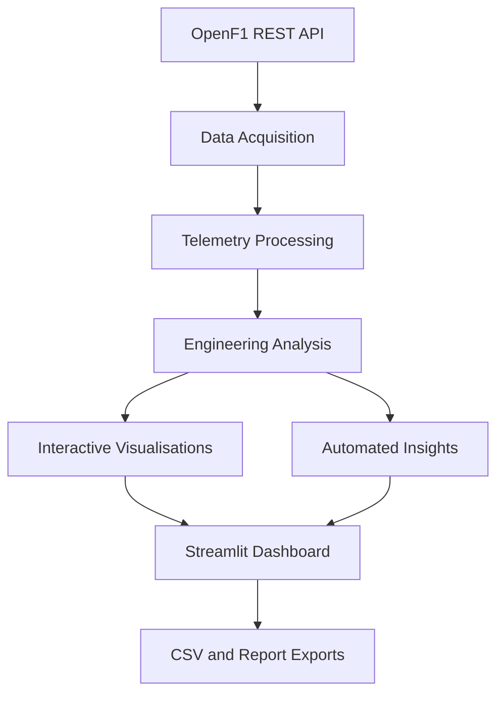

# F1 RaceLab

### Motorsport Telemetry & Performance Analytics Platform


## Project Overview

F1 RaceLab is an interactive motorsport telemetry
and performance analytics platform designed to
compare Formula 1 driver performance using
historical racing data.

The application integrates the OpenF1 REST API
with numerical engineering calculations,
signal processing, automated performance
analysis and interactive data visualisation.

Users can dynamically select Formula 1 seasons,
Grand Prix events, sessions, drivers and laps
without modifying the underlying source code.

## Key Features

- Dynamic season selection from 2023 onwards
- Grand Prix and session selection
- Driver-to-driver performance comparison
- Fastest recorded lap and specific lap selection
- Speed and throttle telemetry
- Automatic braking event detection
- Estimated longitudinal G-force analysis
- Numerical acceleration and deceleration analysis
- Lap time delta calculation
- Automatic track section analysis
- Interactive circuit heatmaps
- Gear usage and engine RPM analysis
- DRS telemetry visualisation
- Tyre compound and estimated tyre age analysis
- Weather data integration
- Automated engineering insights
- Telemetry coverage assessment
- CSV and ZIP data exports
- Automatically generated engineering reports

## Engineering Methodology

### 1. Data Acquisition

Historical Formula 1 telemetry is retrieved
through the OpenF1 REST API.

The application dynamically retrieves:

- Session information
- Driver information
- Lap timing
- Car telemetry
- Circuit positioning
- Tyre stints
- Weather measurements

### 2. Numerical Distance Integration

Vehicle speed is converted from kilometres
per hour to metres per second.

$$
v_{m/s} = \frac{v_{km/h}}{3.6}
$$

Distance is estimated using trapezoidal
numerical integration.

$$
s = \sum_{i=1}^{n-1}
\frac{v_i+v_{i+1}}{2}
(t_{i+1}-t_i)
$$

### 3. Acceleration and Deceleration

Longitudinal acceleration is estimated
through numerical differentiation.

$$
a = \frac{dv}{dt}
$$

Estimated longitudinal deceleration
is expressed in gravitational units.

$$
G = \frac{-a}{9.81}
$$

A moving average is applied to reduce
measurement noise.

### 4. Automatic Braking Detection

Braking events are identified using
transitions in the binary brake signal.

The analysis calculates:

- Braking event duration
- Braking distance
- Initial speed
- Release speed
- Speed reduction
- Average deceleration
- Peak estimated braking G

### 5. Lap Time Delta

Each driver's estimated travelled distance
is normalised to a common lap-progress axis.

$$
p = \frac{s}{s_{total}}
$$

Interpolation enables comparisons between
telemetry signals with different timestamps.

$$
\Delta t(p) = t_B(p)-t_A(p)
$$

Positive values favour Driver A.
Negative values favour Driver B.

### 6. Circuit Mapping

Circuit coordinates are aligned with
vehicle telemetry using nearest-timestamp
matching.

A maximum alignment tolerance of 0.5 seconds
is applied.

Interactive heatmaps visualise speed,
throttle, braking, RPM, gear and DRS.

### 7. Automated Engineering Insights

A deterministic rule-based analysis engine
automatically interprets calculated metrics.

The engine generates observations regarding:

- Lap performance
- Maximum speed
- Braking behaviour
- Throttle utilisation
- Track section performance
- Gear usage
- Telemetry coverage

No generative AI or paid API is required.

## Example Case Study

### 2025 Australian Grand Prix — Qualifying

Lando Norris vs Oscar Piastri

| Metric | Norris | Piastri |
|---|---:|---:|
| Recorded lap time | 75.096 s | 75.180 s |
| Selected lap | 19 | 17 |
| Maximum sampled speed | 329 km/h | 328 km/h |
| Telemetry samples | 278 | 278 |
| Position samples | 285 | 288 |
| Estimated sampled distance | 5190.19 m | 5196.17 m |

Norris completed the selected lap
0.084 seconds faster than Piastri.

These results were obtained during
the historical API integration test.

## Software Architecture



## Project Structure

```text
F1_RaceLab/
├── app.py
├── data_loader.py
├── analysis.py
├── visualisations.py
├── insights.py
├── test_loader.py
├── test_analysis.py
├── test_visualisations.py
├── requirements.txt
├── README.md
├── .gitignore
└── .streamlit/
    └── config.toml
```

## Technologies Used

| Technology | Purpose |
|---|---|
| Python | Application development |
| NumPy | Numerical engineering calculations |
| Pandas | Time-series data processing |
| Requests | REST API integration |
| Plotly | Interactive visualisation |
| Matplotlib | Engineering plots |
| Streamlit | Web application development |
| GitHub | Source code version control |
| OpenF1 | Historical motorsport data |

## Installation

Clone the repository:

```bash
git clone https://github.com/YOUR_USERNAME/F1-RaceLab.git
cd F1-RaceLab
```

Create a virtual environment:

```bash
python -m venv .venv
```

Activate the environment on Windows:

```bash
.venv\Scripts\activate
```

Install dependencies:

```bash
pip install -r requirements.txt
```

Launch the application:

```bash
python -m streamlit run app.py
```

## Testing

The project includes scripts for checking:

- Historical API connectivity
- Driver and session retrieval
- Telemetry acquisition
- Numerical analysis consistency
- Interactive visualisation generation

```bash
python test_loader.py
python test_analysis.py
python test_visualisations.py
```

## Engineering Limitations

- Historical data coverage begins in 2023.
- Data availability varies between sessions.
- Estimated distance is derived from sampled speed.
- Braking G is estimated, not directly measured.
- Binary brake status does not represent pedal pressure.
- Normalised lap alignment is approximate.
- Automatically generated track sections are not
  official Formula 1 corners or sectors.
- Fastest recorded laps may include deleted laps.
- DRS values are displayed as raw status codes.
- Normalised lap timing is not independent validation.
- Sampled time coverage may not identify internal gaps.
- Fuel load, traffic, tyre condition, weather and
  vehicle setup may influence comparisons.
- Automated observations do not establish causation.

## Future Development

- Official sector and corner identification
- GPS-based spatial alignment
- Multi-driver performance comparison
- Tyre degradation modelling
- Race strategy simulation
- Pit stop and undercut analysis
- Predictive lap-time modelling

## Author

Vaishnavi Prabagaran

Electrical and Computer Systems Engineering
Student | Monash University

Interests:
Engineering software, motorsport analytics,
embedded systems, signal processing,
automation and data engineering.

## Data Source

Historical Formula 1 data is provided by:

https://openf1.org/

## Disclaimer

This is an independent educational engineering
project and is not affiliated with Formula 1,
the FIA or any Formula 1 team.
